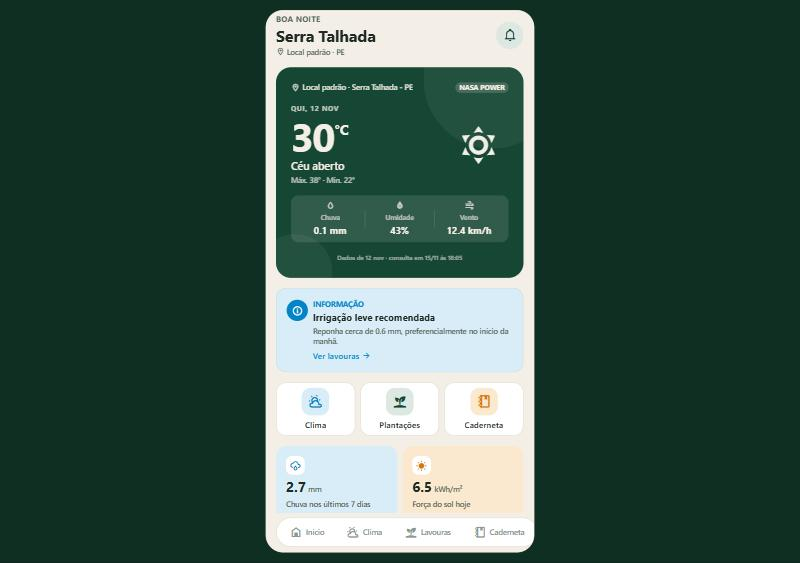
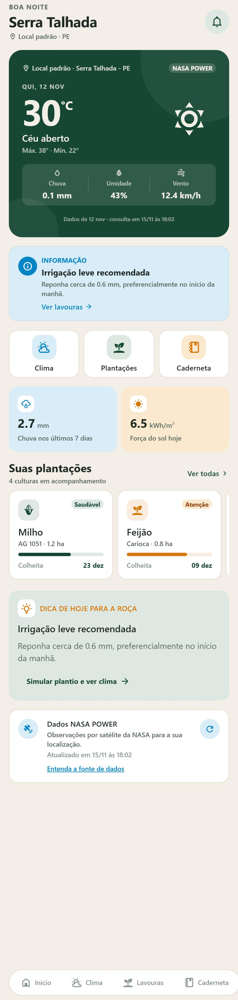
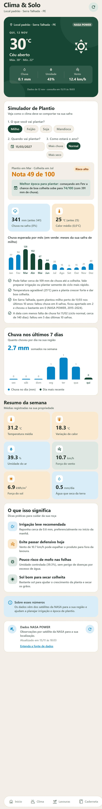
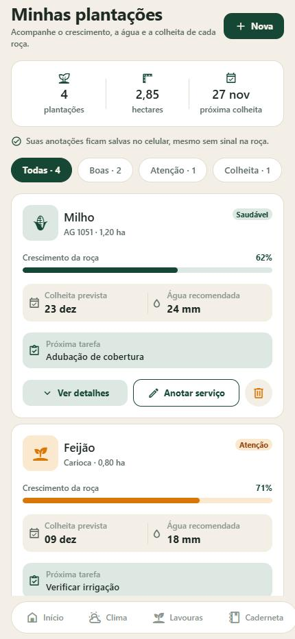
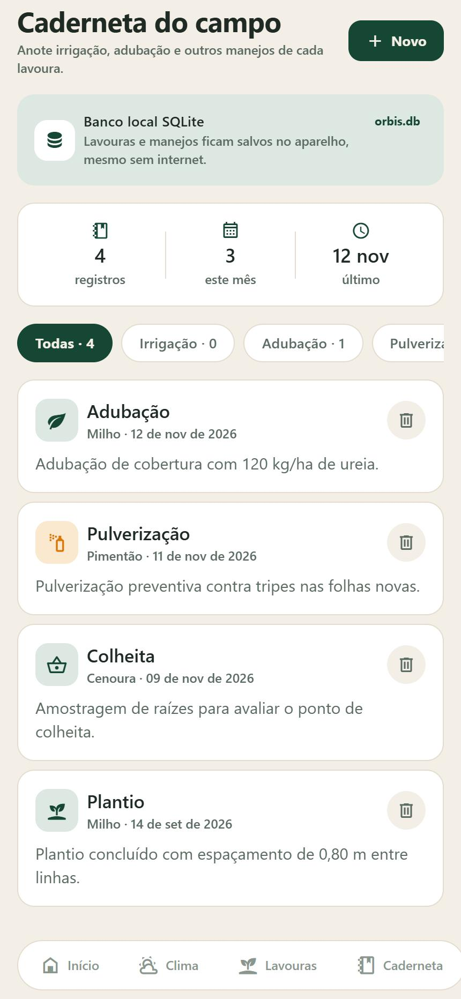
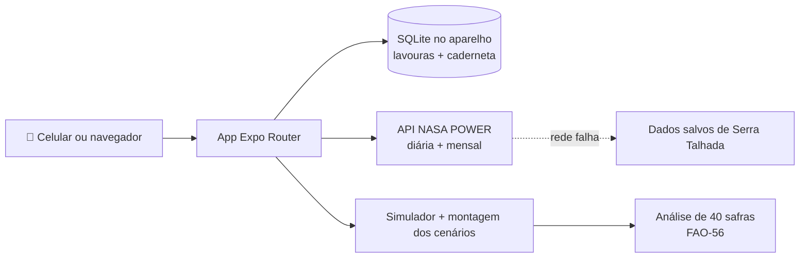

<div align="center">

<h1>🌱 Orbis</h1>

<p><b>Antes de plantar, teste a decisão contra 40 anos de dados da NASA.</b><br/>
Um conselheiro de plantio no bolso do agricultor familiar do Sertão brasileiro.</p>

<p>
  <a href="https://joaomanoel01s-team-orbis.expo.app/"></a>
  <a href="https://joaomanoel01s-team-orbis.expo.app/?lang=en"></a>
</p>

<p>
  
  
  
  
  
  
</p>

<sub>🇧🇷 Português · <a href="./README.md">🇺🇸 English</a></sub>

<br/>



</div>

---

## 🌾 O problema

No Sertão de Pernambuco, o agricultor familiar planta uma vez por ano e aposta a safra inteira nas primeiras chuvas. Em **Serra Talhada**, a chuva média é de cerca de **648 mm por ano**, mas um único ano pode trazer **218 mm ou 1.299 mm**. Entre 1985–94 e 2015–24, a média caiu de **683 mm para 547 mm**, e os dias com 35 °C ou mais passaram de **118 para 145 por ano**. As ferramentas de previsão são feitas para o grande produtor, falam em termos técnicos e dizem pouco sobre a escolha que importa: *o que eu planto e em que data?*

## 💡 A ideia

**O Orbis transforma 40 anos de dados de satélite da NASA em uma resposta clara para uma roça**, em linguagem simples, no celular que o agricultor já tem.

1. **Abre o app.** Ele lê a localização (ou usa Serra Talhada) e mostra o clima real dos últimos dias.
2. **Escolhe a cultura, a data e o tipo de ano.** Os três "anos" não são previsões inventadas: são **anos reais** que aconteceram naquele ponto.
3. **Lê o veredito.** Uma nota de 0 a 100, a melhor época de plantio, a chuva esperada e uma frase simples como:
   > *"Em Serra Talhada, quem plantou milho perto de 21/01 nos últimos 10 anos: faltou chuva em 8 safras, ficou apertado em 1 e choveu o bastante em 1 (NASA POWER, 2015–2024)."*

<table>
<tr>
<td align="center" width="25%"><br/><sub><b>Início</b><br/>clima de hoje e avisos</sub></td>
<td align="center" width="25%"><br/><sub><b>Clima + Simulador</b><br/>nota, melhor época, dicas</sub></td>
<td align="center" width="25%"><br/><sub><b>Lavouras</b><br/>roças salvas no celular</sub></td>
<td align="center" width="25%"><br/><sub><b>Caderneta</b><br/>diário de campo, funciona offline</sub></td>
</tr>
</table>

> 🌐 **Para a banca:** o app tem um botão **PT | EN** (canto superior direito no computador, última aba no celular). Ou abra a demo com `?lang=en`.

---

## 🎯 Como o Orbis responde aos critérios de avaliação

| Critério | O que fizemos |
| --- | --- |
| **Impacto** | Atende quem mais sente o risco climático e menos tem ferramentas: o agricultor familiar do semiárido. Mostra *o risco da data* antes de a semente e o dinheiro irem para a terra: milho plantado em 21/01 ficou sem chuva suficiente em 8 das últimas 10 safras, contra 5 em 11/02. Roda em celular simples, guarda as anotações offline e fala em português claro. |
| **Validade** | Todo número vem da NASA POWER. Os cenários são **médias de anos reais** (sem multiplicadores inventados; removemos uma heurística inicial que se rotulava como CMIP6). O resultado das safras usa o método FAO-56 (ETo de Hargreaves × Kc), com fontes em [`docs/REFERENCES.md`](./docs/REFERENCES.md), e cada suposição e limite está em [`docs/METHODOLOGY.md`](./docs/METHODOLOGY.md). Quando faltam dados, o app avisa em vez de chutar. |
| **Relevância para o desafio** | *Field Shift: Adapting Farms with NASA Data*: as séries diária e mensal da NASA POWER alimentam clima, irrigação, cenários e a análise de 40 safras, para ajudar a **adaptar a decisão de plantio** a um clima que muda. |
| **Criatividade** | Cenários como *anos que de fato aconteceram* ("como nos anos mais chuvosos", "como nos mais secos") em vez de modelos climáticos abstratos; um veredito que o agricultor lê em uma linha; uma camada de dados que degrada com honestidade (dados da NASA salvos no app para Serra Talhada se a rede falhar). |
| **Apresentação** | Interface mobile-first, com moldura de celular no computador, demo bilíngue publicada, verificação automática dos dados e método documentado. |

## ✨ Funcionalidades

| Tela | O que faz |
| --- | --- |
| **Início** | Saudação, clima do dia, chuva da semana, recomendação de irrigação e alertas automáticos (chuva forte, risco de fungos, vento para pulverização). |
| **Clima** | Série dos últimos 14 dias para a localização do aparelho e o **simulador de plantio**. |
| **Lavouras** | Cadastro das plantações (nome, variedade, área), status e previsão de colheita. |
| **Caderneta** | Diário de campo: irrigação, adubação, pulverização, plantio, colheita e outros manejos. |

### 🧪 Simulador de plantio

O agricultor escolhe **a cultura** (milho, feijão, soja, mandioca), **a data** e **o tipo de ano**: *Mais chuva*, *Normal* ou *Mais seco*.

| Cenário | Construído com | Serra Talhada |
| --- | --- | --- |
| Mais chuva | média dos **10 anos mais chuvosos** de 1985–2024 | ~948 mm/ano |
| Normal | média dos **40 anos** | ~648 mm/ano |
| Mais seco | média dos **10 anos mais secos** de 1985–2024 | ~382 mm/ano |

O app avalia **as 12 janelas de plantio** e mostra a nota (**época boa**, **atenção**, **risco alto**), o melhor mês, chuva e temperatura esperadas comparadas à média de 40 anos e dicas práticas. Na região de Serra Talhada, a nota também respeita o **histórico real das últimas 10 safras** (milho, feijão-caupi e mandioca): se faltou chuva em 6 ou mais, a nota fica em no máximo 49; em 4 ou 5, no máximo 74.

## 🌽 Análise das safras de Serra Talhada

Para Serra Talhada (PE), o time comparou, safra a safra de 1985 a 2024, a chuva de cada ciclo com a necessidade de água de milho, feijão-caupi e mandioca (FAO-56: ETo de Hargreaves × coeficiente de cultura Kc), a partir dos dados diários da NASA POWER. Cada safra foi classificada como "Choveu o bastante", "Ficou apertado" ou "Faltou chuva", para nove datas de plantio entre 1º de janeiro e 21 de março. Método, limites e fontes: [`docs/METHODOLOGY.md`](./docs/METHODOLOGY.md) e [`docs/REFERENCES.md`](./docs/REFERENCES.md).

## 🛰️ Dados da NASA

Duas consultas à [API NASA POWER](https://power.larc.nasa.gov/docs/services/api/) (comunidade `AG`, agroclimatologia). Não é necessária chave de API.

| Uso | Endpoint | Parâmetros |
| --- | --- | --- |
| Clima recente (14 dias) | `temporal/daily/point` | `T2M`, `T2M_MAX`, `T2M_MIN`, `PRECTOTCORR`, `RH2M`, `WS2M`, `ALLSKY_SFC_SW_DWN`, `EVLAND` |
| Histórico mensal ano a ano (1985–2024) | `temporal/monthly/point` | `T2M`, `PRECTOTCORR_SUM` (total do mês; se faltar, `PRECTOTCORR` × dias do mês) |

### ⚠️ Como os cenários são calculados

Os cenários **não são projeções do futuro**. A API de projeção da NASA POWER (CMIP6) **não cobre o Brasil**, por isso o app não a consulta. Se a consulta online falhar perto de Serra Talhada (até 0,75°), o app usa uma cópia da NASA POWER salva no próprio app ([`src/data/serra-talhada-clima.json`](./src/data/serra-talhada-clima.json), acessada em 14/11/2026) e avisa isso nas notas da simulação. Em qualquer outro lugar, mostra erro: **nenhum dado é inventado**. Os resultados são uma **ferramenta de apoio à decisão, não uma previsão garantida**.

## 🏗️ Arquitetura



- **Sem backend**: o app consulta a NASA POWER diretamente.
- **Offline-first para os dados do produtor**: lavouras e caderneta ficam em **SQLite** no aparelho.
- **Localização real**: GPS quando permitido; senão, **Serra Talhada (PE)** é o local padrão, e a posição real o substitui quando o GPS responder.
- **Fallback honesto**: o clima diário cai numa série marcada "DEMO"; os cenários caem nos dados salvos da NASA só perto de Serra Talhada.
- **Bilíngue**: botão PT/EN com tradução de todas as telas.

```
src/
├── app/            # Telas (Expo Router): index, clima, lavouras, caderneta, mercado
├── components/     # Componentes de UI e cartões (simulador, clima, lavouras...)
├── context/        # Localização do dispositivo
├── db/             # Schema e repositório SQLite
├── hooks/          # useNasaClimate, useNasaProjection, useCrops, useActivities
├── lib/            # Regras puras: simulador, cenários, alertas, i18n
├── services/       # Integração com a NASA POWER
├── data/           # Séries da NASA para Serra Talhada e resultado das 40 safras
└── types/          # Tipos TypeScript
```

## 🚀 Como rodar

**Pré-requisitos:** Node.js (LTS) e npm. Para testar no celular, o [Expo Go](https://expo.dev/go) ou um [development build](https://docs.expo.dev/develop/development-builds/introduction/).

```bash
npm install
npx expo start
```

```bash
npm run android   # emulador ou dispositivo Android
npm run ios       # simulador iOS (macOS)
npm run web       # navegador
```

Para checar o código: `npm run lint` e `npx tsc --noEmit`. Para conferir a camada de dados sem internet: `node --import ./scripts/ts-register.mjs scripts/verificar-dados.ts` (ou `npx tsx scripts/verificar-dados.ts`). Relatórios de teste: [`BUILD_LOG.md`](./BUILD_LOG.md) e [`docs/TESTES.md`](./docs/TESTES.md).

## ⚠️ Limitações conhecidas

- As faixas ideais de chuva e temperatura das culturas são valores de referência simplificados; devem ser validadas com a assistência técnica local (Embrapa, Emater).
- A irrigação usa uma regra simples (evapotranspiração menos chuva do dia). A evapotranspiração usada é o `EVLAND` (evapotranspiração real do modelo de superfície da NASA POWER), **não** a de referência (ETo) da FAO-56.
- Os dados diários da NASA POWER têm atraso de cerca de 3 dias: o "hoje" do app é o dia mais recente disponível.
- Os cenários são médias de anos passados (1985–2024), não projeções do clima futuro.
- A frase das safras e o teto da nota valem só perto de Serra Talhada (até 0,75°) e para milho, feijão-caupi e mandioca. Os limites (6 ou mais faltas em 10 → 49; 4 ou 5 → 74) são uma escolha do time.
- A radiação solar da NASA POWER chega com mais atraso; nos dias sem leitura o app repete a mais recente.
- A tela de Mercado usa dados fictícios e está fora das abas.
- Testado no Chromium; Safari, Firefox e aparelhos físicos ainda precisam ser verificados.

## 🗺️ Próximos passos

- Projeções reais do clima futuro para o Brasil (por exemplo, NASA NEX-GDDP-CMIP6).
- Servidor próprio como proxy e cache da NASA POWER.
- Levar a análise das safras (FAO-56) para outros municípios do Semiárido.
- Mais culturas e variedades, validadas por especialistas.
- Sensores de solo e coeficiente de cultura (Kc).

## 🤖 Uso de IA

Ferramentas de IA (Claude) foram usadas para apoiar o código, a análise e os textos. Os dados vêm da NASA POWER e as decisões foram revisadas pelo time.

## 📄 Licença

Distribuído sob a licença MIT. Veja o arquivo [`LICENSE`](./LICENSE).

## 🙏 Agradecimentos

- **NASA POWER**, pelos dados abertos de agroclimatologia.
- A organização do **NASA Space Apps**.
- **Embrapa** e **IBGE**, pelas referências regionais em [`docs/REFERENCES.md`](./docs/REFERENCES.md).
- Aos agricultores familiares, que inspiram este projeto.

<div align="center"><sub>Feito em Pernambuco 🇧🇷 pelo time <b>Agreste Cósmico</b> · NASA Space Apps Challenge 2026</sub></div>
