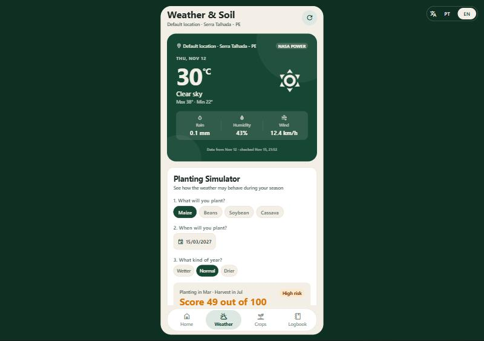
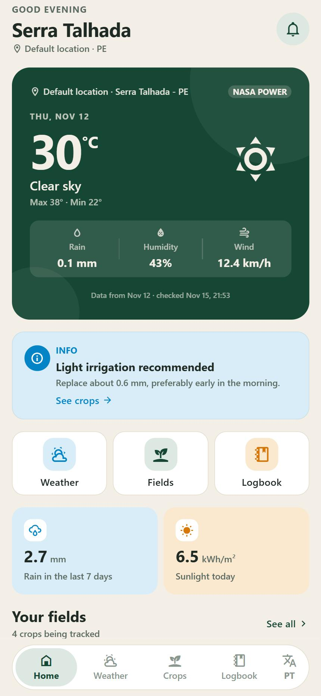
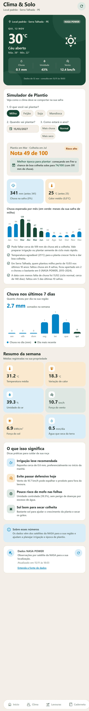
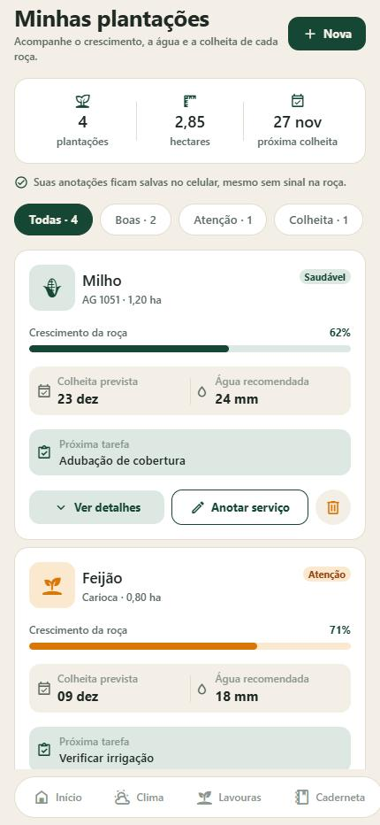
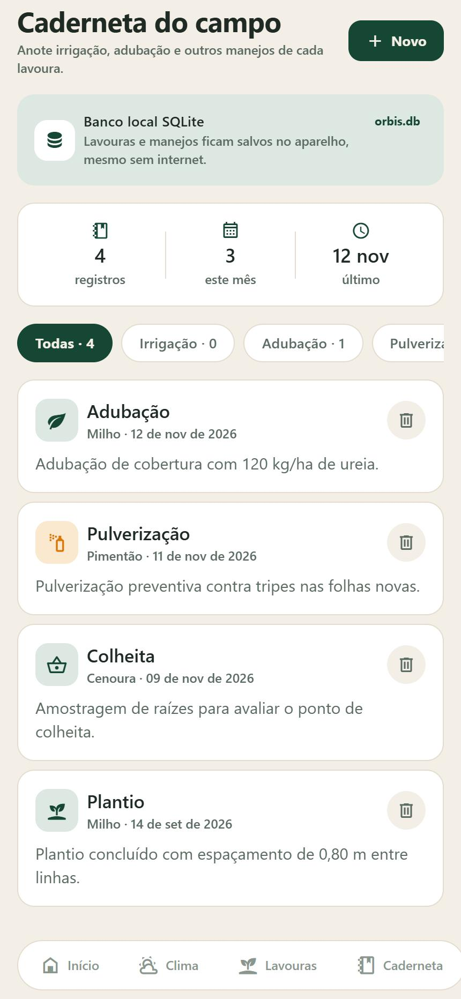
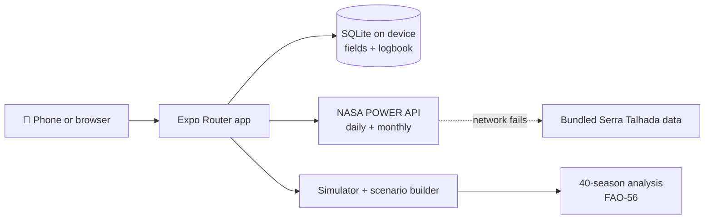

<div align="center">

<h1>🌱 Orbis</h1>

<p><b>Before you plant, test the decision against 40 years of NASA data.</b><br/>
A pocket planting advisor for family farmers in Brazil's semi-arid Sertão.</p>

<p>
  <a href="https://joaomanoel01s-team-orbis.expo.app/?lang=en"></a>
  <a href="https://joaomanoel01s-team-orbis.expo.app/"></a>
</p>

<p>
  
  
  
  
  
  
</p>

<sub>🇺🇸 English · <a href="./README.br.md">🇧🇷 Português</a></sub>

<br/>



</div>

---

## 🌾 The problem

In the Sertão of Pernambuco, a family farmer plants once a year and bets the whole season on the first rains. In **Serra Talhada**, annual rainfall averages about **648 mm**, but a single year can bring **218 mm or 1,299 mm**. Between 1985–94 and 2015–24 the average fell from **683 mm to 547 mm**, and days at or above 35 °C went from **118 to 145 per year**. Forecast tools are built for large producers, speak in technical terms, and say little about the choice that matters: *what do I plant, and on which date?*

## 💡 The idea

**Orbis turns 40 years of NASA satellite data into one clear answer for one field**, in plain language, on the phone the farmer already has.

1. **Open the app.** It reads the location (or falls back to Serra Talhada) and shows the real weather of the last days.
2. **Pick a crop, a date and a kind of year.** The three "years" are not invented forecasts: they are **real years** that happened at that exact point.
3. **Read the verdict.** A 0–100 score, the best planting window, expected rain, and a plain sentence like:
   > *"In Serra Talhada, farmers who planted maize around Jan 21 in the last 10 years: rain fell short in 8 seasons, was tight in 1 and was enough in 1 (NASA POWER, 2015–2024)."*

<table>
<tr>
<td align="center" width="25%"><br/><sub><b>Home</b><br/>today's weather and alerts</sub></td>
<td align="center" width="25%"><br/><sub><b>Weather + Simulator</b><br/>score, best window, tips</sub></td>
<td align="center" width="25%"><br/><sub><b>Crops</b><br/>fields saved on the phone</sub></td>
<td align="center" width="25%"><br/><sub><b>Logbook</b><br/>field diary, works offline</sub></td>
</tr>
</table>

> 🌐 **For the judges:** the app has a **PT | EN button** (top right on desktop, last tab on a phone). Or open the demo with `?lang=en`.

---

## 🎯 How Orbis answers the evaluation criteria

| Criterion | What we did |
| --- | --- |
| **Impact** | Targets the people who bear the most climate risk and have the least tooling: family farmers in the semi-arid region. It shows *the date risk* before the money and seed are in the ground: planting maize on Jan 21 fell short of rain in 8 of the last 10 seasons, versus 5 on Feb 11. It runs on a basic phone, keeps field notes offline, and speaks plain Portuguese. |
| **Validity** | Every number traces to NASA POWER. Scenarios are **averages of real years** (no invented multipliers; we removed an early heuristic that mislabeled itself as CMIP6). The crop-season result uses the FAO-56 method (Hargreaves ETo × Kc) with sources in [`docs/REFERENCES.md`](./docs/REFERENCES.md), and every assumption and limit is declared in [`docs/METHODOLOGY.md`](./docs/METHODOLOGY.md). When data is missing, the app says so instead of guessing. |
| **Relevance to the challenge** | *Field Shift: Adapting Farms with NASA Data*: NASA POWER daily and monthly series drive weather, irrigation advice, scenarios and the 40-season analysis, to help farms **adapt planting decisions** to a shifting climate. |
| **Creativity** | Scenarios as *years that really happened* ("like the 10 wettest years", "like the 10 driest") rather than abstract climate models; a verdict farmers can read in one line; a data layer that degrades honestly (saved NASA data for Serra Talhada if the network fails). |
| **Presentation** | Mobile-first interface in a phone frame on desktop, a bilingual live demo, an automated data check, and a documented method. |

## ✨ Features

| Screen | What it does |
| --- | --- |
| **Home** | Greeting, today's weather, week's rain, irrigation advice and automatic alerts (heavy rain, fungal risk, wind for spraying). |
| **Weather** | 14-day series for the device location and the **planting simulator**. |
| **Crops** | Register fields (name, variety, area), follow status and expected harvest. |
| **Logbook** | Field diary: irrigation, fertilizing, spraying, planting, harvest and other tasks. |

### 🧪 Planting simulator

The farmer chooses **a crop** (maize, beans, soybean, cassava), **a date**, and **a kind of year**: *Wetter*, *Normal* or *Drier*.

| Scenario | Built from | Serra Talhada |
| --- | --- | --- |
| Wetter | average of the **10 wettest years** in 1985–2024 | ~948 mm/yr |
| Normal | average of all **40 years** | ~648 mm/yr |
| Drier | average of the **10 driest years** in 1985–2024 | ~382 mm/yr |

It evaluates the **12 possible planting months**, then shows a score (**good time**, **caution**, **high risk**), the best month, expected rain and temperature versus the 40-year average, and practical tips. In the Serra Talhada region, the score also follows the **real record of the last 10 seasons** (maize, cowpea and cassava): if rain fell short in 6 or more, the score is capped at 49; in 4 or 5, at 74.

## 🌽 Serra Talhada crop-season analysis

For Serra Talhada (PE), the team compared, season by season from 1985 to 2024, the rainfall of each cycle with the water demand of maize, cowpea and cassava (FAO-56: Hargreaves ETo × crop coefficient Kc) from NASA POWER daily data. Each season is classified as "enough rain", "tight" or "rain fell short" for nine planting dates between January 1 and March 21. Method, limits and sources: [`docs/METHODOLOGY.md`](./docs/METHODOLOGY.md) and [`docs/REFERENCES.md`](./docs/REFERENCES.md).

## 🛰️ NASA data

Two kinds of queries to the [NASA POWER API](https://power.larc.nasa.gov/docs/services/api/) (`AG` agroclimatology community). No API key required.

| Use | Endpoint | Parameters |
| --- | --- | --- |
| Recent weather (14 days) | `temporal/daily/point` | `T2M`, `T2M_MAX`, `T2M_MIN`, `PRECTOTCORR`, `RH2M`, `WS2M`, `ALLSKY_SFC_SW_DWN`, `EVLAND` |
| Year-by-year monthly history (1985–2024) | `temporal/monthly/point` | `T2M`, `PRECTOTCORR_SUM` (monthly total; falls back to `PRECTOTCORR` × days in month) |

### ⚠️ How the scenarios are built

The scenarios are **not projections of the future**. The NASA POWER projection API (CMIP6) does not cover Brazil, so the app does not call it. If the online query fails near Serra Talhada (within 0.75°), the app uses a copy of NASA POWER data bundled with the app ([`src/data/serra-talhada-clima.json`](./src/data/serra-talhada-clima.json), accessed on 2026-11-14) and says so in the simulation notes. Anywhere else it shows an error: **no data is made up**. Results are a **decision-support tool, not a guaranteed forecast**.

## 🏗️ Architecture



- **No backend**: the app queries NASA POWER directly.
- **Offline-first for farmer data**: fields and logbook live in on-device **SQLite**.
- **Real location**: GPS when allowed; otherwise **Serra Talhada (PE)** is the default location, and the real position replaces it once GPS answers.
- **Honest fallback**: daily weather falls back to a labeled "DEMO" series; scenarios fall back to bundled NASA data only near Serra Talhada.
- **Bilingual**: PT/EN switch with in-app translation of all screens.

```
src/
├── app/            # Screens (Expo Router): index, clima, lavouras, caderneta, mercado
├── components/     # UI components and cards (simulator, weather, crops...)
├── context/        # Device location
├── db/             # SQLite schema and repository
├── hooks/          # useNasaClimate, useNasaProjection, useCrops, useActivities
├── lib/            # Pure logic: simulator, scenarios, alerts, i18n
├── services/       # NASA POWER integration
├── data/           # Serra Talhada NASA series and 40-season results
└── types/          # TypeScript types
```

## 🚀 Getting started

**Prerequisites:** Node.js (LTS) and npm. To test on a phone, use [Expo Go](https://expo.dev/go) or a [development build](https://docs.expo.dev/develop/development-builds/introduction/).

```bash
npm install
npx expo start
```

```bash
npm run android   # Android emulator or device
npm run ios       # iOS simulator (macOS)
npm run web       # browser
```

Check the code with `npm run lint` and `npx tsc --noEmit`. Check the data layer offline with `node --import ./scripts/ts-register.mjs scripts/verificar-dados.ts` (or `npx tsx scripts/verificar-dados.ts`). Test reports: [`BUILD_LOG.md`](./BUILD_LOG.md) and [`docs/TESTES.md`](./docs/TESTES.md).

## ⚠️ Known limitations

- Crops' ideal rainfall and temperature ranges are simplified reference values; they should be validated with local agronomy support (Embrapa, Emater).
- Irrigation advice uses a simple rule (evapotranspiration minus the day's rain). The evapotranspiration is `EVLAND` (actual evapotranspiration from NASA POWER's land-surface model), **not** the FAO-56 reference evapotranspiration.
- NASA POWER daily data lags by about 3 days: the app's "today" is the most recent day available.
- Scenarios are averages of past years (1985–2024), not future projections.
- The crop-season sentence and score cap only apply near Serra Talhada (within 0.75°) and to maize, cowpea and cassava. The cap thresholds (6+ short seasons of 10 → 49; 4–5 → 74) are a team choice.
- NASA POWER solar radiation arrives later than other parameters; missing days repeat the latest reading.
- The Market screen uses fictional data and is hidden from the tabs.
- Tested on Chromium; Safari, Firefox and physical devices are still to be verified.

## 🗺️ Roadmap

- Real future-climate projections for Brazil (e.g. NASA NEX-GDDP-CMIP6).
- Own server as a NASA POWER proxy and cache.
- Extend the FAO-56 crop-season analysis to other towns in the semi-arid region.
- More crops and varieties, validated by specialists.
- Soil sensors and crop-coefficient (Kc) integration.

## 🤖 Use of AI

AI tools (Claude) were used to support code, analysis and writing. The data comes from NASA POWER and decisions were reviewed by the team.

## 📄 License

Released under the MIT License. See [`LICENSE`](./LICENSE).

## 🙏 Acknowledgments

- **NASA POWER**, for open agroclimatology data.
- The **NASA Space Apps** organizers.
- **Embrapa** and **IBGE**, for the regional references listed in [`docs/REFERENCES.md`](./docs/REFERENCES.md).
- Family farmers, who inspire this project.

<div align="center"><sub>Made in Pernambuco 🇧🇷 by <b>Agreste Cósmico</b> · NASA Space Apps Challenge 2026</sub></div>
